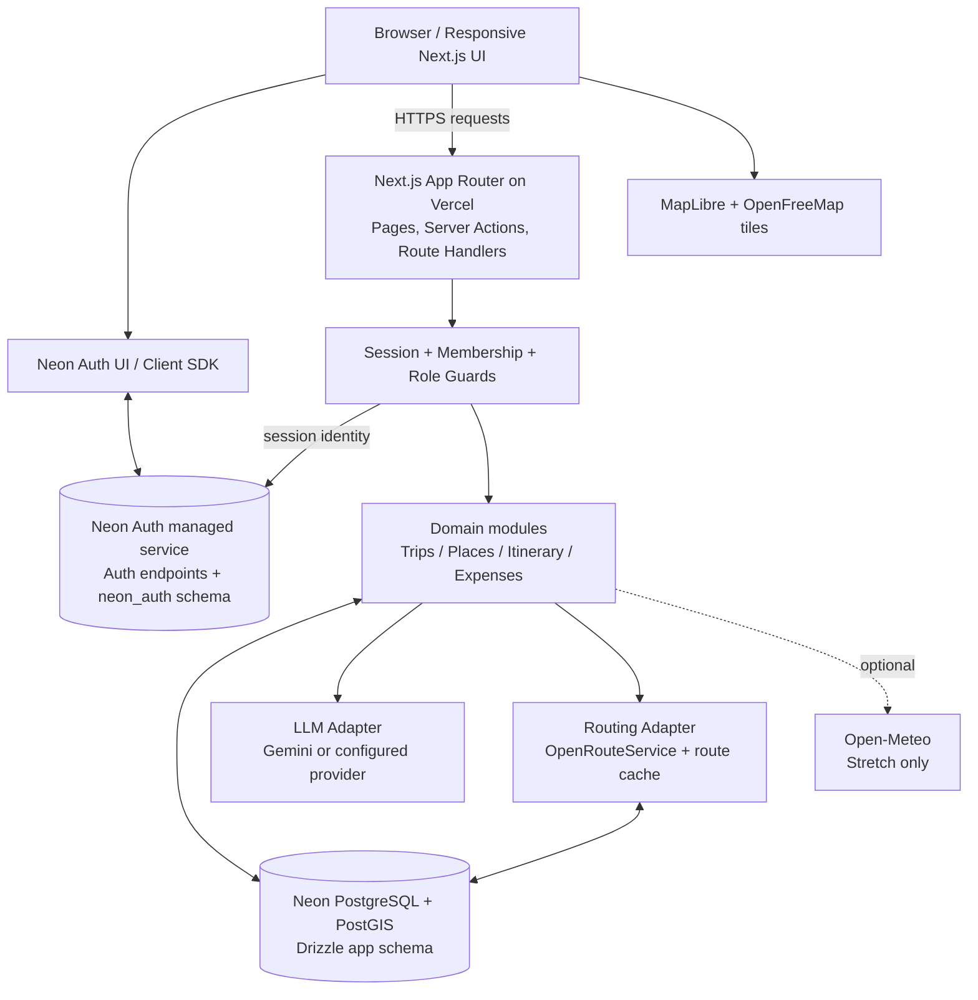
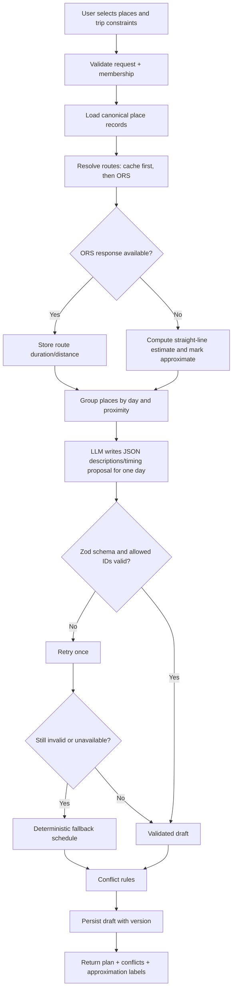

# System Design and Architecture

**Product:** Travel Planner + Expense Tracker (Voyara)  
**Release:** CBC 2.0 hackathon implementation baseline v3  
**Architecture style:** Modular monolith / single Next.js deployment  
**Primary infrastructure:** Vercel + Neon PostgreSQL/PostGIS + Neon Auth  

---

## 1. Architecture decisions

1. **One deployable Next.js application.** Use App Router pages, server components, route handlers, and server actions where appropriate. Do not split the hackathon scope into microservices.
2. **Neon Auth is the authentication system.** Use `@neondatabase/auth` and its supported Next.js integration, with `@neondatabase/auth-ui` if the provided UI fits. Do not create a self-hosted Better Auth server, do not install `better-auth` as the app's auth implementation, and do not define duplicate auth/session/password tables in Drizzle.
3. **Neon PostgreSQL is the app data store.** Use Drizzle for application-owned tables. Neon's managed authentication data belongs to Neon's `neon_auth` schema and is managed by Neon Auth.
4. **All application data access passes through the Next.js server.** Browser components do not connect directly to PostgreSQL. Every trip-scoped read/write runs a shared session + membership guard.
5. **AI proposes structure and language, not facts.** Place IDs are allow-listed from the database; route times come from routing/cache or a labelled geometric estimate; conflict validation is deterministic code.
6. **External providers sit behind wrappers.** Routing, LLM, and optional weather integrations can be replaced or disabled without changing the domain model.
7. **Core features are synchronous and bounded.** Generate one itinerary day per request; cache provider responses; show graceful fallbacks.

## 2. High-level architecture diagram



**Trust boundary:** the browser is untrusted. Authentication establishes identity; the server still authorizes each resource operation based on trip membership and role.

## 3. Technology stack

| Layer | Choice | Responsibility |
|---|---|---|
| Language | TypeScript | Shared types and application logic |
| Framework | Next.js App Router | UI, route handlers, server-side workflows |
| Styling/components | Tailwind CSS, shadcn/ui, Lucide | Responsive UI primitives |
| Client data/state | TanStack Query | Server-state cache, request states, stretch polling |
| Validation | Zod | Request schemas and LLM response validation |
| Date/time | Luxon or equivalent | Date validation and destination-local time handling |
| Auth client | `@neondatabase/auth` | Browser auth client and sign-in/sign-up/session interaction |
| Auth UI | `@neondatabase/auth-ui` (optional/recommended) | Ready-made Neon Auth screens/components where suitable |
| Auth server | `@neondatabase/auth/next/server` | Next.js auth proxy handler, session reads, auth middleware |
| Database | Neon PostgreSQL + PostGIS | Application records, geospatial place search, route cache |
| ORM | Drizzle ORM + Drizzle Kit | App-owned schema and migrations |
| PostgreSQL driver | `@neondatabase/serverless` | Pooled runtime access; use the supported transaction-capable configuration for atomic multi-row updates |
| Map | MapLibre GL JS + OpenFreeMap tiles | Map display without a paid tile key |
| Places | Seeded app-owned table populated by a one-time Overpass script | Search/suggestions do not depend on a live third-party search call |
| Routing | OpenRouteService (ORS) | Route time/distance when available |
| LLM | Provider wrapper; Gemini configured for demo if selected | Suggest itinerary text/timing within a constrained schema |
| Weather | Open-Meteo (stretch) | Optional forecast panel |
| Hosting | Vercel | Web deployment and environment configuration |

**Do not add for the hackathon:** a self-hosted Better Auth server, Resend/SMTP, Pusher, Upstash, Web Push, Sentry, offline/PWA packages, cron jobs, or background queue infrastructure.

## 4. Neon Auth integration design

### 4.1 Responsibilities

Neon Auth handles user identity, credentials, authentication endpoints, and managed session behaviour. The application handles product-specific authorisation: ownership, active trip membership, and what a member may do within a trip.

- Use the exact Auth URL for the selected Neon branch.
- Configure a server-side `NEON_AUTH_COOKIE_SECRET` of at least 32 characters for the Next.js auth integration.
- Initialise the server integration with `createNeonAuth()` from `@neondatabase/auth/next/server`.
- Expose the integration's supported handler under `app/api/auth/[...path]/route.ts` using `auth.handler()`.
- Configure the supported `proxy.ts` middleware for session-aware route handling. Do not rely on middleware alone as the API authorisation boundary.
- Create the browser auth client from the same branch-specific Auth URL and wrap relevant UI in the supported Neon Auth provider/UI.
- Read the signed-in identity through the Neon Auth SDK. Use the returned stable user ID as the app's `user_id`.
- Save `date_of_birth`, travel preferences, and any product-specific profile fields in the app's `profile` table after signup/onboarding.

### 4.2 Auth data ownership

- Neon Auth owns its managed `neon_auth` schema. Do not create or migrate `user`, `session`, `account`, or `verification` tables in the app schema to emulate an auth provider.
- Do not read or write Neon Auth tables directly from app code.
- Do not hash passwords in application code or store passwords in `profile`.
- Do not create a parallel `BETTER_AUTH_SECRET` or `BETTER_AUTH_URL` configuration. Use Neon Auth environment variables.
- Do not expose `DATABASE_URL`, cookie secrets, LLM keys, or ORS keys to the browser.
- A JWKS URL is useful only when a server endpoint must independently verify a Neon Auth JWT (for example, a bearer-token API). For this app's cookie/session-based Next.js routes, prefer the supported Neon Auth server/session integration and do not hand-roll JWT parsing. If JWT verification is implemented for a separate API boundary, use a maintained JWT library and the configured JWKS URL; validate issuer, audience (when applicable), expiry, and required claims.

### 4.3 Suggested integration layout

```text
lib/
  auth/
    server.ts          # createNeonAuth({ baseUrl, cookies })
    client.ts          # createAuthClient(NEON_AUTH_BASE_URL)
    guards.ts          # requireUser, requireTripMember, requireTripOwner
app/
  api/
    auth/
      [...path]/route.ts # export GET and POST from auth.handler()
proxy.ts                 # Neon Auth middleware for route/session handling
```

The exact file paths may be adjusted to the existing app structure, but there must be one shared server auth instance and one shared membership/role guard implementation.

## 5. Neon database connectivity and branch policy

### 5.1 Connection strings

- `DATABASE_URL`: pooled Neon connection for normal server runtime queries.
- `DATABASE_URL_UNPOOLED`: direct/unpooled connection for migrations and operations that require direct connectivity.
- Never paste a connection string into source files or commit it. Use Vercel/local environment variables.
- Use a transaction-capable Neon driver/configuration for atomic expense + split writes and version-checked multi-row itinerary saves. Validate current driver requirements against the installed Neon package version.

### 5.2 Branches and deployment

The provided setup file links the current Neon project to the **`production`** branch. Preserve that branch name for the production deployment. Use a separate development branch for local experimentation if one is created, and set the database URL, Auth URL, and JWKS URL consistently for each environment. Neon Auth endpoints are branch-specific; do not mix a development Auth URL with a production database URL.

The `neon.ts` project config requested by the supplied setup is:

```ts
import { defineConfig } from "@neon/config/v1";

export default defineConfig({
  auth: true,
});
```

Only run the Neon CLI deploy step from the intended repository and linked branch after checking what will be applied.

### 5.3 PostGIS

Enable PostGIS in a migration if the Neon project supports the extension:

```sql
CREATE EXTENSION IF NOT EXISTS postgis;
```

Represent a place coordinate as `geography(Point, 4326)` and create a GiST index for nearby-place queries. Use a Drizzle custom type or SQL fragments for spatial operations where the ORM does not expose the required PostGIS type.

## 6. Proposed code layout

```text
app/
  (public)/                 # landing and public routes
  (auth)/                   # sign-in/sign-up routes or Neon Auth UI wrapper
  dashboard/
  trips/
    [tripId]/               # overview, itinerary, expenses, balances
  join/[code]/
  api/
    auth/[...path]/route.ts
    profile/route.ts
    trips/route.ts
    trips/[tripId]/route.ts
    trips/[tripId]/members/route.ts
    trips/[tripId]/join-code/route.ts
    trips/[tripId]/itinerary/route.ts
    trips/[tripId]/itinerary/generate/route.ts
    trips/[tripId]/itinerary/check/route.ts
    trips/[tripId]/expenses/route.ts
    trips/[tripId]/balances/route.ts
    places/search/route.ts
    places/suggest/route.ts
    places/custom/route.ts
lib/
  auth/                     # Neon Auth client/server and guards
  db/                       # Drizzle client, schema, migrations
  trips/                    # Trip service and membership rules
  places/                   # Search, suggestions, custom place validation
  routing/                  # ORS client, cache, straight-line fallback
  itinerary/                # generation, validation, ordering, conflict rules
  llm/                      # Provider interface, prompts, response schemas
  expenses/                 # integer-paise, split and settle-up functions
  validation/               # Zod request schemas
scripts/
  seed-places.ts
  seed-demo.ts
```

Keep domain calculations in pure service functions where practical. Route handlers should parse input, authenticate/authorise, call the service, and translate domain failures to predictable HTTP responses.

## 7. Application data model

Neon Auth's own identity tables are not duplicated. These are **application-owned** tables; exact SQL types/names can be refined during migrations.

| Table | Key fields | Notes |
|---|---|---|
| `profile` | `user_id` PK, display name, DOB, vibe tags, pace, budget level, timestamps | `user_id` matches the ID returned by Neon Auth; never stores credentials |
| `trip` | UUID, `owner_id`, type, people count, destination, timezone, start/end dates, daily hours, transport mode, `budget_paise`, status, join code, version | Unique join code; code is null for solo trips |
| `trip_member` | `trip_id`, `user_id`, role, joined/removed timestamps | Composite uniqueness; removed membership cannot authorise access |
| `place` | UUID, name, category, geography point, destination, source, opening hours, confidence, description, image URL/licence/author, popularity score, verification status, creator ID | `location` GiST index; name search index |
| `itinerary` | UUID, unique `trip_id`, status, version, updated by/time | Draft/confirmed state; version checked on updates |
| `stop` | UUID, itinerary ID, place ID, day index, start/end local times, sort order, estimated cost in paise, notes | Every stop references a known place; indexed by itinerary/day/order |
| `route_cache` | origin/destination key, transport mode, duration seconds, distance metres, fetched time, source/approximate flag | Unique cache key; do not cache a fallback as exact provider data |
| `expense` | UUID, trip ID, payer ID, amount paise, category, note, spent date/time, split type, version, created by | Positive amount; version checked for edit/delete |
| `expense_split` | expense ID, user ID, share paise | Shares for each eligible participant must sum to the expense amount |
| `settlement` | UUID, trip ID, from-user, to-user, amount paise, status, created/settled timestamps | A record only; no payment movement |
| `checkin` | trip ID, user ID, place ID, status, timestamp | Stretch; latest status per member is sufficient |
| `branch`, `branch_member`, `branch_stop_change` | Branch ID, members, differences from main itinerary | Stretch; do not clone the entire base plan |
| `expense_audit` | expense ID, actor ID, action, before/after payload, timestamp | Stretch; for edits/deletes |

### 7.1 Relationship and integrity rules

- `trip.owner_id` is the identity of the trip creator. A matching owner row should also exist in `trip_member` with role `owner`.
- Application tables store the stable Neon Auth user ID. Avoid coupling app migrations to undocumented internals of the managed `neon_auth` schema; validate session identity through Neon Auth and enforce app relationships in application tables.
- Prefer foreign keys between app-owned tables (`stop.place_id`, `stop.itinerary_id`, `expense_split.expense_id`, etc.).
- Index all `trip_id`-scoped tables. Enforce uniqueness for one itinerary per trip if the product only supports one current itinerary.
- Prefer soft removal for members via `removed_at`, but every authorization query must explicitly require `removed_at IS NULL`.
- Include `created_at` and `updated_at` on mutable domain entities.

## 8. API surface and authorization

Every input is validated with Zod. Authenticated trip routes call the shared membership guard; owner-only actions call an additional owner guard.

| Area | Endpoint | Permission / behaviour |
|---|---|---|
| Auth | `/api/auth/[...path]` | Neon Auth supported handler; no self-hosted Better Auth route |
| Profile | `GET/PUT /api/profile` | Current authenticated user only |
| Trips | `POST/GET /api/trips` | Create trip; list only trips accessible to current user |
| Trip detail | `GET/PUT/DELETE /api/trips/:id` | Member read/update as defined; delete/ownership change owner-only |
| Confirmation | `POST /api/trips/:id/confirm` | Owner-only; rejects unresolved blocking conflicts |
| Reopen | `POST /api/trips/:id/reopen` | Owner-only; unlock itinerary for changes |
| Join code | `POST /api/trips/:id/join-code` | Owner-only; create/regenerate and invalidate previous code |
| Join | `POST /api/join/:code` | Authenticated user; validate eligibility and idempotently add membership |
| Members | `DELETE /api/trips/:id/members/:userId` | Owner-only; cannot remove owner through ordinary member-removal endpoint |
| Place search | `GET /api/places/search` | Search visible app place data; bounded query/page size |
| Suggestions | `GET /api/places/suggest` | Rank based on known interests, destination, season, and stored scores |
| Custom place | `POST /api/places/custom` | Authenticated; validate name and coordinates; prevent malformed coordinates |
| Itinerary generate | `POST /api/trips/:id/itinerary/generate` | Member; day-scoped, generation cap enforced, validates allowed place IDs |
| Itinerary read/write | `GET/PUT /api/trips/:id/itinerary` | Member; writes require expected version and unlocked itinerary |
| Conflict check | `POST /api/trips/:id/itinerary/check` | Member; returns deterministic structured findings |
| Expenses | `GET/POST /api/trips/:id/expenses` | Member; atomic expense/split insert |
| Expense item | `PUT/DELETE /api/expenses/:id` | Active member with permitted access; expected version; audit history is stretch |
| Balances | `GET /api/trips/:id/balances` | Group member; calculated from expense splits and recorded settlements |
| Settle-up | `GET /api/trips/:id/settle` | Group member; deterministic minimal-payment suggestion |
| Settlement status | `POST /api/settlements/:id/mark` | Eligible group member; records status only |
| Check-in (stretch) | `POST /api/trips/:id/checkin` | Active member; manual status only |
| Member status (stretch) | `GET /api/trips/:id/members/status` | Active member; returns latest check-in/status; polling |
| Branch (stretch) | `POST /api/trips/:id/branches` | Active member; stores branch differences |

Use consistent error shapes for `400` validation errors, `401` unauthenticated requests, `403` unauthorised/non-member requests, `404` inaccessible or missing resources, `409` version/state conflicts, `429` generation caps, and `5xx` provider/server failures. Avoid leaking whether another user's private trip exists; a `404` may be used for both missing and inaccessible records.

## 9. Itinerary generation pipeline



### 9.1 Rules

1. Accept trip dates, daily hours, budget, preferences, and selected place IDs.
2. Validate selected IDs against the app-owned `place` table. Do not pass unbounded user-supplied place objects to the LLM.
3. Read routing cache first; call ORS only for misses and only within a bounded request budget.
4. Group and order stops with deterministic proximity logic (a nearest-neighbour heuristic is sufficient for the hackathon).
5. Ask the LLM for structured text/timing suggestions for **one day per request**. The model must not create place IDs or authoritative route times.
6. Parse with Zod. Reject malformed output, extra IDs, omitted required IDs, invalid time ranges, and values outside supported bounds. Retry once with validation feedback.
7. If the LLM is down, rate limited, or still invalid, use a rule-based schedule with default stop durations.
8. Run deterministic conflict checks and persist the draft with a version number.
9. Never silently substitute an approximate route duration without a visible “approximate” indicator.

## 10. Deterministic conflict checker

The conflict engine is pure domain code and does not use an LLM to decide whether a conflict exists. Each finding returns a stable `type`, `severity`, `stopIds`, `message`, and `suggestedFix`.

| Rule | Detection | Suggested fix examples |
|---|---|---|
| Overlap | Stop start/end intervals overlap within a day | Move a stop, shorten a duration, or reorder stops |
| Closed place | Known opening-hours data says the stop is outside opening hours | Select an open time or another date/place |
| Impossible transfer | Route duration exceeds available gap between consecutive stops | Increase the gap, reorder, or remove a stop |
| Day too long | Stop timings exceed the trip's configured daily time window | Move a stop to another day or shorten the plan |
| Over budget | Estimated itinerary cost exceeds the trip budget | Replace paid stops, reduce costs, or increase the budget |
| Unknown opening hours | Place has no sufficiently reliable hours record | Show warning and allow explicit override |

Warnings and blocking errors must be visually distinct. The policy for any override must be explicit and recorded in the confirmation request; a warning override must not waive unrelated blocking errors.

## 11. Place seeding, search, and maps

1. Select two or three demo destinations.
2. Run `scripts/seed-places.ts` once to retrieve suitable tourist places from OpenStreetMap/Overpass.
3. Clean duplicates, normalise categories, store source attribution, and include image author/licence when images are added.
4. Hand-verify opening hours for the demonstration places and mark the confidence `verified`; otherwise use `source` or `unknown`.
5. Insert the curated subset into Neon. The deployed application's normal search/suggest flow reads the database and does not call Overpass.
6. Allow users to create a custom place by entering a name and pin. Such a place should be marked user-provided/unverified and must still have a valid app-generated ID before appearing in an itinerary.
7. Use MapLibre for rendering and OpenFreeMap tiles. Handle missing coordinates and tile/network failure without breaking the itinerary editor.

## 12. Expense and settlement design

### 12.1 Creating an expense

1. Validate amount is a positive integer number of paise after conversion/normalisation, category/date/payer, and eligible participants.
2. Calculate split shares with a pure deterministic helper.
3. Validate that each share is non-negative and that the total shares equal the expense total.
4. In one database transaction, insert the expense and every split row. If any insert fails, roll back the entire operation.
5. Increment or set the appropriate version during edits; return a `409` when the version supplied by the client is stale.

### 12.2 Balance calculation

For each group member, net balance is derived from what the member paid minus their recorded share, adjusted for settlement records according to their status. Positive balance means they are owed money; negative balance means they owe money. The algorithm must be documented and tested against fixtures.

### 12.3 Settle-up suggestion

Sort or repeatedly select the largest debtor and largest creditor, propose the minimum of the debt and credit, then reduce the two balances and continue until all balances are zero (within exact paise arithmetic). Ties must be resolved deterministically. Marking a settlement only changes the record status; it does not trigger a financial transaction.

## 13. Caching and fallback behaviour

| Data/service | Normal behaviour | Failure behaviour |
|---|---|---|
| Neon Auth | Use branch-specific managed Auth endpoint and SDK session handling | Show actionable auth error; do not bypass auth or create a local password fallback |
| Places | Read seeded app database | Continue with cached/seeded rows; custom add remains available |
| Route duration | Read `route_cache`, then call ORS | Use straight-line estimate marked approximate |
| LLM itinerary | Generate one day, validate JSON, cache successful demo result | Retry once, then deterministic itinerary fallback |
| Weather (stretch) | Fetch from Open-Meteo | Hide weather section or show unavailable state |
| Neon cold start | Standard loading state | Retry once where safe; avoid duplicate writes |

## 14. Environment configuration

Use a committed `.env.example` containing **variable names and placeholders only**. Real values belong in local `.env.local` or the Vercel environment configuration.

```dotenv
# Database: use values copied from Neon for the appropriate branch
DATABASE_URL=
DATABASE_URL_UNPOOLED=

# Neon Auth: Auth URL for the same branch as DATABASE_URL
NEON_AUTH_BASE_URL=
NEXT_PUBLIC_NEON_AUTH_URL=
NEON_AUTH_COOKIE_SECRET=
# Only needed for server endpoints that manually verify Neon Auth JWTs
NEON_AUTH_JWKS_URL=

# External providers
ORS_API_KEY=
LLM_PROVIDER=gemini
LLM_API_KEY=

# Application
APP_URL=http://localhost:3000
```

Never prefix server secrets with `NEXT_PUBLIC_`. Only the Auth URL is public configuration; database passwords, cookie secrets, Gemini keys, and ORS keys are not.

## 15. Test strategy

### Unit tests

- Equal and exact expense splitting, including remainders and invalid share totals.
- Balance calculations and settle-up payment count/amounts.
- Conflict detection for overlapping stops, known closures, transfer gaps, day length, budget, and unknown-hours warnings.
- Route fallback marking and LLM output validation/unknown IDs.

### Integration tests

- Neon Auth session lookup for signed-in/signed-out requests.
- Profile creation tied to the real session user ID.
- Membership guard for a member, removed member, owner, and unrelated user.
- Join flow for valid, invalid, and regenerated code; duplicate join idempotency.
- Itinerary optimistic-concurrency conflict (`409`).
- Atomic expense + split creation and edit version conflict.

### Manual end-to-end test

Rehearse the complete demo with two real Neon Auth test accounts on the same branch, including at least one provider-failure fallback. Never use a guessed or fabricated Auth user ID in the seed data.

## 16. Deployment and implementation runbook

1. Confirm Node.js LTS, pnpm, Git, and the correct repository working directory.
2. Configure the Neon CLI for the intended project/branch using the commands in `REQUIREMENTS.txt`.
3. Add `neon.ts` with `auth: true` and run Neon deploy only after verifying the linked project and branch.
4. Set local environment values for the matching database and Auth endpoint. Generate a fresh `NEON_AUTH_COOKIE_SECRET` using a cryptographically secure random generator.
5. Install the app dependencies, run lint/typecheck/tests, and apply Drizzle migrations using the unpooled connection as required.
6. Seed the curated place data and create a real demo identity through Neon Auth; seed app-owned demo trip/expense data against that identity.
7. Configure Vercel variables separately for preview/development and production; ensure URLs come from the matching branch.
8. Verify sign-up/sign-in/logout, session expiry behaviour, profile onboarding, and membership/role guards in the deployed build.
9. Warm the deployed database and rehearse the complete demo.

## 17. Official Neon Auth references

- [Neon Auth Next.js integration guide](https://github.com/neondatabase/neon-js/blob/main/packages/auth/NEXT-JS.md)
- [Neon Auth SDK README](https://github.com/neondatabase/neon-js/blob/main/packages/auth/README.md)
- [Neon Auth architecture and branch behaviour](https://neon.com/blog/neon-auth-branchable-identity-in-your-database)

Because the SDK is evolving, follow the installed package's current types and official guide when implementing imports or UI components. Do not copy self-hosted Better Auth server configuration into this app.

